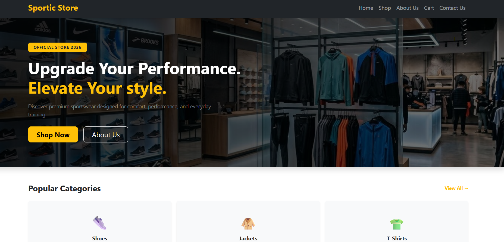
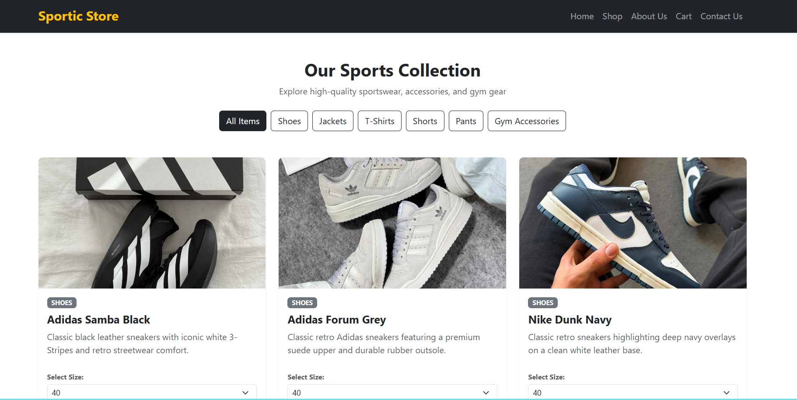
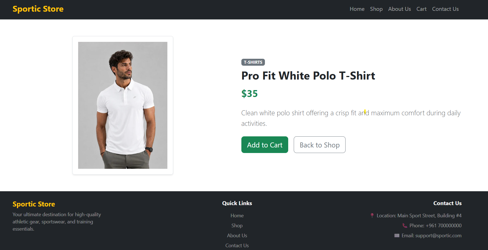
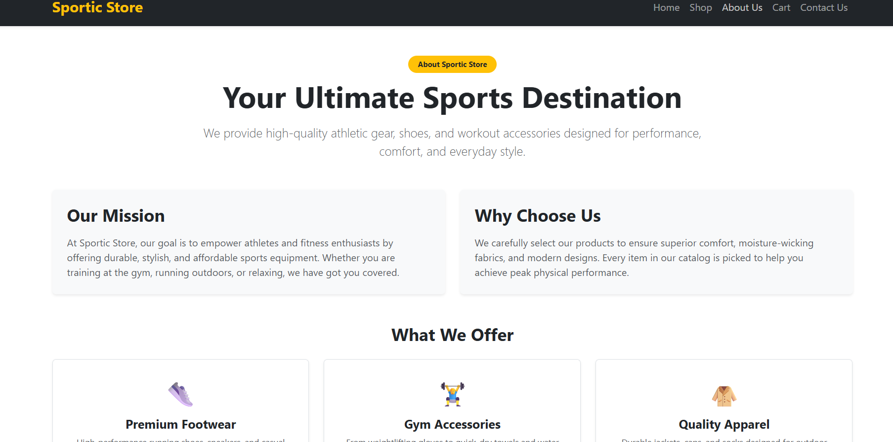
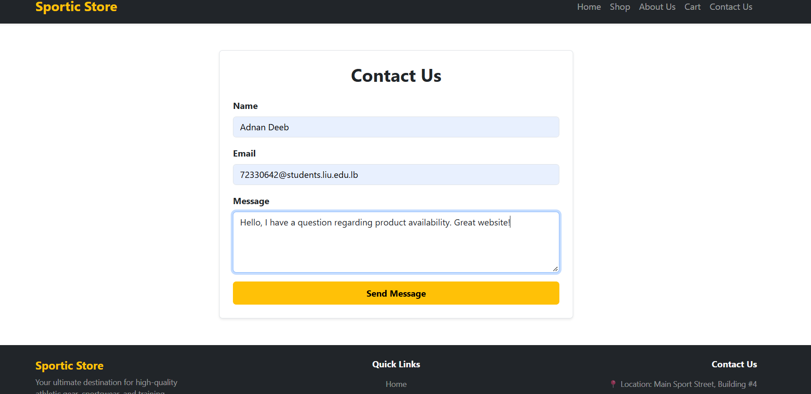

# 🏋️‍♂️ Sportic Store - E-Commerce Web Application

---

## 🎓 Academic Project Information
- **Student Name:** Adnan Naji Deeb
- **Student ID:** 72330642
- **University:** Lebanese International University (LIU)
- **Course:** CSCI426 - Advanced Web Programming (Phase 1)
- **Project Title:** Sportic Store E-Commerce Platform
- **Project Type** Individual Project(Contribution by Adnan Naji Deeb)
---

## 🔗 Project Links
- 🌐 **Live Website (Vercel):** [https://sportic-store-app.vercel.app/](https://sportic-store-app.vercel.app/)
- 📁 **GitHub Repository:** [https://github.com/72330642-Adnan/sportic-store-app](https://github.com/72330642-Adnan/sportic-store-app)

---

## 📝 Project Overview
**Sportic Store** is a modern, responsive e-commerce web application built for sports gear and athletic apparel using **React.js**. Developed for **CSCI426: Advanced Web Programming (Phase 1)**, this platform allows users to browse product categories, view special sales with discount badges, inspect individual product details, and manage selected items inside a dynamic shopping cart.
---
## ✨ Key Features
- **Responsive Layout:** Built with Bootstrap 5 grid utilities to ensure seamless viewing across desktop, tablet, and mobile devices.
- **Client-Side Routing:** Implemented single-page navigation across all sections (Home, Shop, About, Contact, Product Details, and Cart) using
- `react-router-dom`.
- **Dynamic Data Rendering:** Product items, category metrics, and promotional items are dynamically rendered from a centralized dataset (`data.js`).
- **Special Offers & Discounts:** Special section featuring discount badges and original price strike-throughs.
- **Interactive Cart System:** Users can add products using "Cart" buttons with instant automatic navigation to the cart page (`/cart`).
---
## 🛠️ Tech Stack
- **Frontend Framework:** React.js
- **Routing:** React Router DOM (v6)
- **Styling:** Bootstrap 5 & Custom CSS
- **Deployment Platform:** Vercel
- **Version Control:** Git & GitHub
---
## 🚀 Local Installation & Setup

To run this project on your local machine:

1. **Clone the repository:**
   ```bash
   git clone [https://github.com/72330642-Adnan/sportic-store-app.git](https://github.com/72330642-Adnan/sportic-store-app.git)


2. ** Navigate into the project folder:**
cd sportic-store-app

3. ** Install dependencies:**
npm install

4. ** Run the application:**
npm start

## 📸 Screenshots

### Home Page


### Shop Page


### Product Details


### Cart Page


### About Page


### Contact Page



## 📜 Academic Integrity Statement

This project was developed independently by **Adnan Naji Deeb** as an individual effort for the CSCI426 course at Lebanese International University (LIU).